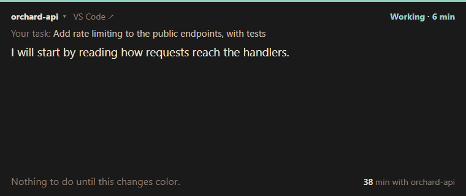
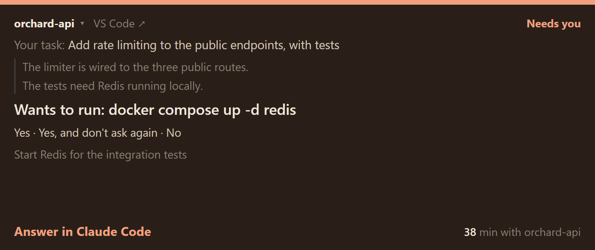
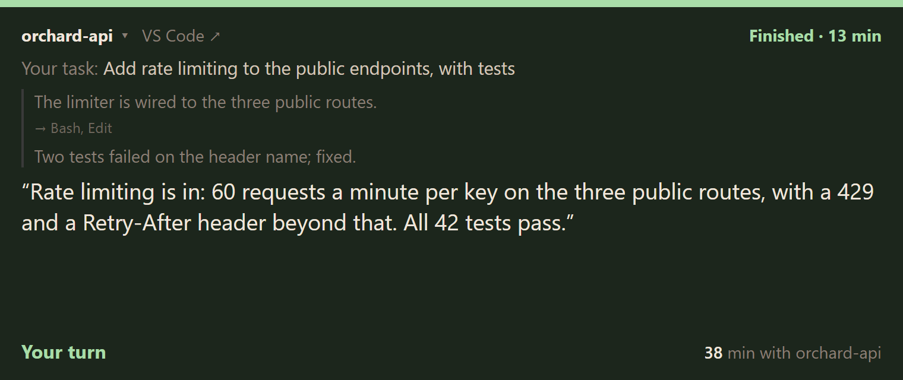
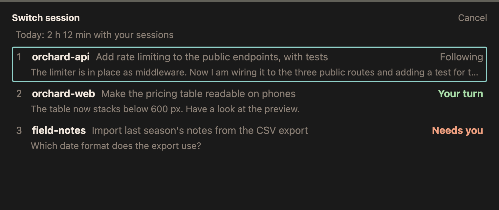

# softgaze

A quiet window for staying with one Claude Code session while it works.
It keeps your task in sight, shows what Claude says it is doing, and changes
color once, when it is your turn. Nothing ticks, nothing scores you, and the
window never jumps to another session on its own.

<p align="center">
  <br>
  <sub>One turn: teal while Claude works, orange when it needs you, green when it is done.</sub>
</p>

<p align="center">
  
  <br>
  <sub>The color changes once, when it is your turn: a question or a permission (orange), or done (green).</sub>
</p>

softgaze is a small Go server plus a VS Code extension. The server reads
Claude Code's transcripts in `~/.claude/projects` and its PID files in
`~/.claude/sessions`, and serves the window on `http://127.0.0.1:3133`. It
makes no LLM calls, installs no hooks and leaves Claude Code's settings
alone.

## What the window shows

The window locks onto one session: your task at the top, then what Claude
has said, then where things stand.

- **Working** (teal line): Claude's latest words and how many minutes the
  turn has run. Nothing to do until the color changes. A message stays
  until you have had time to read it (3 s plus a quarter second a word, at
  most 45 s); a newer one waits, marked by a faint dot after the minutes.
- **Needs you** (warm orange): a question or a permission request, with its
  options.
- **Finished** (green): your turn, with how long the turn took. **Stopped**
  if you interrupted it.
- **In the background**: Claude ended its turn but is waiting on background
  work and will carry on by itself, so it is not your turn yet.
- **Can't tell** (a dashed line, no color): Claude Code reported a status
  softgaze does not know, or none, or says it is busy while the transcript
  shows no prompt softgaze can read. Usually this means Claude Code changed
  what it writes and the parser needs a look; the log names the new status.
- **Session closed**: the session's process is gone. Switch to another one.

After 7 pm the colors get warmer and a little softer.

## Install

softgaze has two parts: the app, which runs in the background, and the VS
Code extension, which opens the window.

**1. The app.** With Homebrew (macOS, Linux):

```bash
brew install fabioconcina/softgaze/softgaze
softgaze service install         # start now and on every login
```

Without Homebrew, download the binary for your system from
[the latest release](https://github.com/fabioconcina/softgaze/releases/latest),
put it somewhere permanent on your `PATH` and run `softgaze service install`:

```bash
# macOS (Apple Silicon; softgaze-darwin-amd64 for Intel)
curl -Lo softgaze https://github.com/fabioconcina/softgaze/releases/latest/download/softgaze-darwin-arm64
chmod +x softgaze
xattr -d com.apple.quarantine softgaze   # if Gatekeeper blocks it

# Linux (x86_64; softgaze-linux-arm64 for ARM)
curl -Lo softgaze https://github.com/fabioconcina/softgaze/releases/latest/download/softgaze-linux-amd64
chmod +x softgaze

# Windows: download softgaze-windows-amd64.exe from the releases page.
# If Defender blocks it: Unblock-File softgaze-windows-amd64.exe
```

Or with Go: `go install github.com/fabioconcina/softgaze@latest`.

**2. The extension.** Search for **Softgaze** in the VS Code Extensions
view, or:

```bash
code --install-extension fabioconcina.softgaze
```

To update: `brew upgrade softgaze` (or download the new binary), then
`softgaze service restart`. VS Code updates the extension by itself.

`service install` registers a LaunchAgent on macOS, a systemd user unit on
Linux, or a script in the Startup folder on Windows. `service status`,
`service restart` and `service uninstall` do what they say. The service logs
to `~/.softgaze/softgaze.log` (on Linux to the journal:
`journalctl --user -u softgaze`).

To run it in the foreground instead: `softgaze` (add `-open` to open the
window in the browser, `-port` or `-db` to override the config, `-log` to
write the log to a file).

### What it needs

- Claude Code, in VS Code or in a terminal. softgaze reads what Claude Code
  writes to `~/.claude`, which is not a documented format: after a Claude
  Code update the window may say **Can't tell** until softgaze catches up.
  Please open an issue when it does.
- VS Code 1.85 or later for the extension. Without it the window still
  works in a browser, but Enter cannot take you to the session's Claude
  Code tab and, on macOS, the minutes counter cannot tell your windows
  apart.
- macOS, Windows or Linux. On Linux the minutes counter needs X11 with
  `xprop`; on Wayland it stays off, and the rest works.

### Privacy

Everything stays on your machine. softgaze listens on `127.0.0.1` only,
refuses requests that come from other websites or other host names, makes
no network calls of its own, and has no telemetry. It reads transcripts and
never writes to `~/.claude`. See [SECURITY.md](SECURITY.md) to report a
problem.

## Use

Open it with **Softgaze: Open** in VS Code. It gets a VS Code window of its
own, with a locked editor group so files never open beside it. A browser on
`http://127.0.0.1:3133` works too.

The window starts empty and locks onto the session you prompt next. From
then on it stays there until you switch.

| Key | What it does |
| --- | --- |
| Enter | Go to the session's VS Code window and its Claude Code tab |
| Ctrl+Alt+J | The same from softgaze; from VS Code, back to softgaze |
| S | Switch session (in the list, 1-9 picks a row) |
| Left / Right | Step through the sessions of the current work period |
| F | Toggle full screen |
| ? | Show the keys; ? again or Esc hides them |

The keys stay hidden until you ask for them. When it is your turn, a click
anywhere in the window also takes you to VS Code.

On macOS, Ctrl+Alt+J brings forward the softgaze panel from whichever VS Code
window holds it, and Enter goes to the VS Code that is already running
rather than starting a second one.

### Work periods

Claude Code sessions stay open for days, so "running" is not the same as
"current". softgaze puts all your prompts on one timeline and learns, from
your own history, how long a pause has to be to mark the end of a working
day. The switch list and the arrow keys show the sessions of the current
work period first; older ones are a click away.

<p align="center">
  
</p>

## Wellbeing

On by default:

- **Minutes with the session**: how long you have stayed with this window,
  as plain minutes. It pauses while another window is in front. No records,
  no streaks.
- **A break line**: when it is your turn and you have been at it for 90
  minutes without a 15-minute pause, the window says a short break would fit
  here. Once per run.
- **Today's minutes** next to each session in the switch list. Minutes only,
  never a count of turns.

Turn all three off with `"wellbeing": false` in the config.

### On macOS

macOS tells softgaze which app is in front but not which window, unless it
has the Accessibility permission, which softgaze does not ask for. The
extension fills the gap: each VS Code window reports when it has the
keyboard, which folders it has open and whether its softgaze panel is
active, and the softgaze page reports when it has the keyboard. Keep the
extension installed so the counter can tell your project's window from any
other.

On Windows and Linux (X11) softgaze reads window titles instead.

## Config

Optional, in `~/.softgaze/config.json`. Every field has a default:

```json
{
  "port": 3133,
  "claude_dir": "~/.claude",
  "db_path": "~/.softgaze/focus.db",
  "wellbeing": true
}
```

The database only holds focus stretches for the minutes counter, pruned
after 30 days. If you change the port, set `softgaze.port` in VS Code to
match.

## Development

```bash
make test    # go test ./..., then the window's renderers (node --test)
make vet
make build
make ext
make screenshots   # retake the images in assets/ from invented sessions
```

Pure Go, no CGO. The window is plain JavaScript with no dependencies.

### Layout

- `main.go`: flags, the `service` subcommand, startup.
- `internal/config`: `~/.softgaze/config.json` and its defaults.
- `internal/parser`: sessions from transcripts and PID files (`follow.go`,
  `followcache.go`), work periods and runs of work (`workperiod.go`), focus
  stretches (`focus.go`).
- `internal/server`: the HTTP API (`/api/follow`, `/api/follow/sessions`,
  `/api/follow/focus`, `/api/follow/back`, `/api/attention/editor`,
  `/api/attention/page`), the event stream, and the
  host and origin guards.
- `internal/watcher`: watches transcripts and PID files and tells the window
  to refresh.
- `internal/attention`: which window is in front. Windows and X11 from window
  titles; macOS from the app in front plus the reports from the extension and
  the page (`hints.go`).
- `internal/ontop`: moving between softgaze and VS Code.
- `internal/store`: the SQLite database of focus stretches.
- `internal/service`: start on login, per platform.
- `web/follow.html`, `web/follow.js`: the window, embedded in the binary.
- `webtest/`: Node tests for the window's renderers.
- `extension/`: the VS Code extension.
